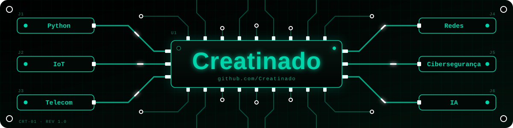

<div align="center">



<a href="https://github.com/Creatinado">
  
</a>

<br />

<a href="https://github.com/Creatinado?tab=followers"></a>
<a href="https://github.com/Creatinado?tab=repositories"></a>
</div>

<br />

## Sobre mim

```diff
+ $ cat sobre.txt
+
+ Nome ........... Creatinado
+ Função ......... Desenvolvedor
+ Formação ....... Técnico em IoT · Técnico em Telecom
+ Linguagem ...... Python
+
+ > Programo em Python, principalmente automação e ferramentas de terminal
+ > Tenho o pé no hardware e na infraestrutura de IoT e telecomunicações
+ > Gosto de investigar redes a fundo: pilha TCP/IP, protocolos e tráfego
+ > Estudo cibersegurança para proteger o que eu construo
+ > Uso IA no dia a dia: Claude Code, GPT Codex e DeepSeek
+
+ "Entender como a rede funciona por baixo dos panos e automatizar o resto."
```

<br />

## Áreas de atuação

<table>
  <tr>
    <td align="center" width="33%">
      <br /><br />
      <b>Desenvolvimento</b><br />
      <sub>Scripts, bots e ferramentas em Python</sub>
    </td>
    <td align="center" width="33%">
      <br /><br />
      <b>Telecom</b><br />
      <sub>Infraestrutura, enlaces e equipamentos de rede</sub>
    </td>
    <td align="center" width="33%">
      <br /><br />
      <b>IoT</b><br />
      <sub>Dispositivos conectados e sensores</sub>
    </td>
  </tr>
  <tr>
    <td align="center" width="33%">
      <br /><br />
      <b>Redes e TCP/IP</b><br />
      <sub>Protocolos, roteamento e diagnóstico</sub>
    </td>
    <td align="center" width="33%">
      <br /><br />
      <b>Cibersegurança</b><br />
      <sub>Segurança de redes e de aplicações</sub>
    </td>
    <td align="center" width="33%">
      <br /><br />
      <b>Inteligência Artificial</b><br />
      <sub>Agentes de código e desenvolvimento assistido</sub>
    </td>
  </tr>
</table>

<br />

## Tecnologias e ferramentas

<div align="center">

&nbsp;&nbsp;&nbsp;
&nbsp;&nbsp;&nbsp;
&nbsp;&nbsp;&nbsp;
&nbsp;&nbsp;&nbsp;
&nbsp;&nbsp;&nbsp;
&nbsp;&nbsp;&nbsp;
&nbsp;&nbsp;&nbsp;
&nbsp;&nbsp;&nbsp;
&nbsp;&nbsp;&nbsp;


<br /><br />


</div>

<br />

## IA no meu fluxo de trabalho

<div align="center">


</div>

<br />

## Projetos em destaque

<table>
  <tr>
    <td width="50%" valign="top">
      <h3><a href="https://github.com/Creatinado/Cooklean">Cooklean</a></h3>
      <p>Limpador de cookies para Linux e Windows: lista e elimina os cookies guardados por navegadores e aplicativos, com limpeza automática e monitor de estatísticas.</p>
      
      
      
      
    </td>
    <td width="50%" valign="top">
      <h3><a href="https://github.com/Creatinado/claude-mod-menu">claude-mod-menu</a></h3>
      <p>Mod menu feito em Dear ImGui com o tema escuro do Claude.</p>
      
      
      
      
    </td>
  </tr>
  <tr>
    <td width="50%" valign="top">
      <h3><a href="https://github.com/Creatinado/ping">ping</a></h3>
      <p>Ferramenta de ping em Python para testar conectividade direto do terminal.</p>
      
      
      
    </td>
    <td width="50%" valign="top">
      <h3><a href="https://github.com/Creatinado/Sevex-bot">Sevex-bot</a></h3>
      <p>Bot multi-device em Node.js, com menus de comandos e instalação via Termux.</p>
      
      
      
      
    </td>
  </tr>
</table>

<div align="center">
  <br />
  <a href="https://github.com/Creatinado?tab=repositories"></a>
</div>

<br />

## Contribuições e números no GitHub

<div align="center">


<br /><br />


</div>

<div align="center">


</div>
